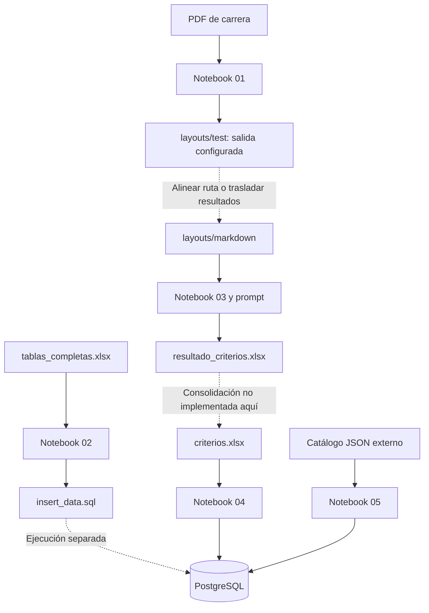

# Documentación de Athena

La documentación de `Scripts` está en `Docs/scripts`. Hay **155 fichas Markdown, una por cada archivo físico encontrado en `Scripts`**, además de este índice. La revisión corresponde al 2026-10-19 e incluye archivos ocultos y cachés para que el inventario sea completo. No se ejecutaron los notebooks, los comandos de Cloud SQL ni cargas de PostgreSQL para documentarlos.

## Organización

La estructura de carpetas de `Docs/scripts` refleja la de `Scripts`. Cada ficha conserva el nombre y la extensión original y añade `.md`; por ejemplo, `1.pdf → 1.pdf.md`, `1.md → 1.md.md` y `05_generate_dataset_trainee.ipynb → 05_generate_dataset_trainee.ipynb.md`. Los `.DS_Store` se documentan como `_DS_Store.md` para que sus fichas sean visibles.

```text
Docs/
├── index.md                         # Entrada y catálogo completo
├── scripts/
│   ├── gcloud/                      # Activación de Cloud SQL
│   ├── python/
│   │   ├── jupyter/                 # Cinco notebooks y lib/set_envs.py
│   │   └── assets/
│   │       ├── requirements.txt.md  # Dependencias del entorno
│   │       ├── prompts/             # Instrucciones de extracción
│   │       ├── layouts/
│   │       │   ├── pdf/             # 66 documentos académicos
│   │       │   ├── markdown/        # 66 textos de perfiles
│   │       │   └── excel/           # Tres libros de preparación
│   │       └── media/extraction_result/ # Libro resultado
│   └── ...                          # Fichas de metadatos en su ruta equivalente
├── Backend/                         # Carpeta existente, aún sin documentación
├── Database/                        # Carpeta existente, aún sin documentación
├── Frontend/                        # Carpeta existente, aún sin documentación
├── github/                          # Carpeta existente, aún sin documentación
└── library/                         # Carpeta existente, aún sin documentación
```

Cada ficha explica el propósito, sus entradas y salidas o estructura, sus relaciones y las condiciones de uso observadas. Incluye enlaces relativos al original, a fichas relacionadas y de regreso a este índice. Las cifras de PDF y Excel corresponden a los archivos guardados, no a una consulta de servicios externos.

## Ruta de lectura y flujo de trabajo

1. Preparar el entorno con [requirements.txt](scripts/python/assets/requirements.txt.md) y revisar [set_envs.py](scripts/python/jupyter/lib/set_envs.py.md).
2. Consultar los PDF y sus Markdown de carrera, enlazados en el catálogo inferior. El notebook 01 realiza la conversión, pero su salida configurada necesita alinearse con la carpeta que lee el 03.
3. Leer [02_generalte_construct_sql.ipynb](scripts/python/jupyter/02_generalte_construct_sql.ipynb.md) para transformar el libro de catálogos en SQL; su ejecución posterior en PostgreSQL es una operación separada.
4. Leer [prompt.md](scripts/python/assets/prompts/prompt.md.md) y [03_extract_criteria_for_careers.ipynb](scripts/python/jupyter/03_extract_criteria_for_careers.ipynb.md) para obtener los criterios de perfil y su trazabilidad.
5. Revisar [criterios.xlsx](scripts/python/assets/layouts/excel/criterios.xlsx.md) antes de [04_submit_criteria_from_sql.ipynb](scripts/python/jupyter/04_submit_criteria_from_sql.ipynb.md). No existe en los notebooks revisados una consolidación automática desde el resultado del 03 a ese libro.
6. Usar [05_generate_dataset_trainee.ipynb](scripts/python/jupyter/05_generate_dataset_trainee.ipynb.md) para entender la generación sintética, sus controles y la carga por área. El catálogo JSON requerido está fuera de `Scripts`.



## Notebooks y configuración

| Archivo documentado | Función | Efectos al ejecutar |
| --- | --- | --- |
| [01_normalize_pdf_to_md.ipynb](scripts/python/jupyter/01_normalize_pdf_to_md.ipynb.md) | Extrae PDF a Markdown | Escribe/reemplaza archivos; la salida actual es `layouts/test` |
| [02_generalte_construct_sql.ipynb](scripts/python/jupyter/02_generalte_construct_sql.ipynb.md) | Genera SQL de áreas, escuelas y carreras | Sobrescribe `DataBase/scripts/insert_data.sql`; no ejecuta el SQL |
| [03_extract_criteria_for_careers.ipynb](scripts/python/jupyter/03_extract_criteria_for_careers.ipynb.md) | Extrae RIASEC y completa evidencia | Llama a Gemini/Google Search, crea caché y reemplaza el Excel |
| [04_submit_criteria_from_sql.ipynb](scripts/python/jupyter/04_submit_criteria_from_sql.ipynb.md) | Carga el Excel consolidado de criterios | La celda final de carga confirma una transacción en DB |
| [05_generate_dataset_trainee.ipynb](scripts/python/jupyter/05_generate_dataset_trainee.ipynb.md) | Genera y valida datasets por área | `SUBIR_DB=True`; carga datos al ejecutar su celda de confirmación |
| [set_envs.py](scripts/python/jupyter/lib/set_envs.py.md) | Centraliza entorno y conexión | Solo lee el entorno al importarse; no abre conexiones |
| [requirements.txt](scripts/python/assets/requirements.txt.md) | Lista dependencias Python | El archivo por sí solo no instala ni ejecuta nada |

## Cloud SQL

| Archivo | Operación |
| --- | --- |
| [upload_services.sh](scripts/gcloud/upload_services.sh.md) | Política ALWAYS de `athena-db`; no despliega código |
| [stop_services.sh](scripts/gcloud/stop_services.sh.md) | Política NEVER de `athena-db` |

## Prompt y libros Excel

| Archivo | Estructura y uso |
| --- | --- |
| [prompt.md](scripts/python/assets/prompts/prompt.md.md) | Reglas de extracción PERFIL → INTERNET → CONTINGENCIA |
| [tablas_completas.xlsx](scripts/python/assets/layouts/excel/tablas_completas.xlsx.md) | 3 áreas, 66 carreras, 26 escuelas y 79 relaciones; entrada del 02 |
| [objetivos_resumidos.xlsx](scripts/python/assets/layouts/excel/objetivos_resumidos.xlsx.md) | Tres hojas auxiliares de objetivos/preguntas/habilidades, 66 registros por hoja |
| [criterios.xlsx](scripts/python/assets/layouts/excel/criterios.xlsx.md) | 397 criterios consolidados; entrada del 04 |
| [resultado_criterios.xlsx](scripts/python/assets/media/extraction_result/resultado_criterios.xlsx.md) | 331 criterios de perfil, 26 fuentes y 66 filas de cobertura; salida del 03 |

## Catálogo de archivos académicos

Cada fila enlaza dos fichas independientes. La identidad de la carrera y el área se verificaron en `tablas_completas.xlsx`; los números corresponden a los nombres de archivo, no a posiciones alfabéticas. Los 66 PDF suman 284 páginas.

### Área 1: Ingeniería y Ciencias Físico Matemáticas (43 carreras)

| ID | Carrera | PDF | Markdown |
| ---: | --- | --- | --- |
| 1 | Ingeniería Aeronáutica | [1.pdf](scripts/python/assets/layouts/pdf/1.pdf.md) | [1.md](scripts/python/assets/layouts/markdown/1.md.md) |
| 2 | Ingeniería Ambiental | [2.pdf](scripts/python/assets/layouts/pdf/2.pdf.md) | [2.md](scripts/python/assets/layouts/markdown/2.md.md) |
| 3 | Ingeniería Biomédica | [3.pdf](scripts/python/assets/layouts/pdf/3.pdf.md) | [3.md](scripts/python/assets/layouts/markdown/3.md.md) |
| 4 | Ingeniería Biónica | [4.pdf](scripts/python/assets/layouts/pdf/4.pdf.md) | [4.md](scripts/python/assets/layouts/markdown/4.md.md) |
| 5 | Ingeniería Bioquímica | [5.pdf](scripts/python/assets/layouts/pdf/5.pdf.md) | [5.md](scripts/python/assets/layouts/markdown/5.md.md) |
| 6 | Ingeniería Biotecnológica | [6.pdf](scripts/python/assets/layouts/pdf/6.pdf.md) | [6.md](scripts/python/assets/layouts/markdown/6.md.md) |
| 7 | Ingeniería Civil | [7.pdf](scripts/python/assets/layouts/pdf/7.pdf.md) | [7.md](scripts/python/assets/layouts/markdown/7.md.md) |
| 8 | Ingeniería Eléctrica | [8.pdf](scripts/python/assets/layouts/pdf/8.pdf.md) | [8.md](scripts/python/assets/layouts/markdown/8.md.md) |
| 9 | Ingeniería en Alimentos | [9.pdf](scripts/python/assets/layouts/pdf/9.pdf.md) | [9.md](scripts/python/assets/layouts/markdown/9.md.md) |
| 10 | Ingeniería en Computación | [10.pdf](scripts/python/assets/layouts/pdf/10.pdf.md) | [10.md](scripts/python/assets/layouts/markdown/10.md.md) |
| 11 | Ingeniería en Comunicaciones y Electrónica | [11.pdf](scripts/python/assets/layouts/pdf/11.pdf.md) | [11.md](scripts/python/assets/layouts/markdown/11.md.md) |
| 12 | Ingeniería en Control y Automatización | [12.pdf](scripts/python/assets/layouts/pdf/12.pdf.md) | [12.md](scripts/python/assets/layouts/markdown/12.md.md) |
| 13 | Ingeniería en Energía | [13.pdf](scripts/python/assets/layouts/pdf/13.pdf.md) | [13.md](scripts/python/assets/layouts/markdown/13.md.md) |
| 14 | Ingeniería en Informática | [14.pdf](scripts/python/assets/layouts/pdf/14.pdf.md) | [14.md](scripts/python/assets/layouts/markdown/14.md.md) |
| 15 | Ingeniería en Inteligencia Artificial | [15.pdf](scripts/python/assets/layouts/pdf/15.pdf.md) | [15.md](scripts/python/assets/layouts/markdown/15.md.md) |
| 16 | Ingeniería en Meteorología | [16.pdf](scripts/python/assets/layouts/pdf/16.pdf.md) | [16.md](scripts/python/assets/layouts/markdown/16.md.md) |
| 17 | Ingeniería en Movilidad Urbana | [17.pdf](scripts/python/assets/layouts/pdf/17.pdf.md) | [17.md](scripts/python/assets/layouts/markdown/17.md.md) |
| 18 | Ingeniería en Negocios Energéticos Sustentables | [18.pdf](scripts/python/assets/layouts/pdf/18.pdf.md) | [18.md](scripts/python/assets/layouts/markdown/18.md.md) |
| 19 | Ingeniería en Robótica Industrial | [19.pdf](scripts/python/assets/layouts/pdf/19.pdf.md) | [19.md](scripts/python/assets/layouts/markdown/19.md.md) |
| 20 | Ingeniería en Sistemas Ambientales | [20.pdf](scripts/python/assets/layouts/pdf/20.pdf.md) | [20.md](scripts/python/assets/layouts/markdown/20.md.md) |
| 21 | Ingeniería en Sistemas Automotrices | [21.pdf](scripts/python/assets/layouts/pdf/21.pdf.md) | [21.md](scripts/python/assets/layouts/markdown/21.md.md) |
| 22 | Ingeniería en Sistemas Computacionales | [22.pdf](scripts/python/assets/layouts/pdf/22.pdf.md) | [22.md](scripts/python/assets/layouts/markdown/22.md.md) |
| 23 | Ingeniería en Sistemas Energéticos y Redes Inteligentes | [23.pdf](scripts/python/assets/layouts/pdf/23.pdf.md) | [23.md](scripts/python/assets/layouts/markdown/23.md.md) |
| 24 | Ingeniería en Transporte | [24.pdf](scripts/python/assets/layouts/pdf/24.pdf.md) | [24.md](scripts/python/assets/layouts/markdown/24.md.md) |
| 25 | Ingeniería Farmacéutica | [25.pdf](scripts/python/assets/layouts/pdf/25.pdf.md) | [25.md](scripts/python/assets/layouts/markdown/25.md.md) |
| 26 | Ingeniería Ferroviaria | [26.pdf](scripts/python/assets/layouts/pdf/26.pdf.md) | [26.md](scripts/python/assets/layouts/markdown/26.md.md) |
| 27 | Ingeniería Fotónica | [27.pdf](scripts/python/assets/layouts/pdf/27.pdf.md) | [27.md](scripts/python/assets/layouts/markdown/27.md.md) |
| 28 | Ingeniería Geofísica | [28.pdf](scripts/python/assets/layouts/pdf/28.pdf.md) | [28.md](scripts/python/assets/layouts/markdown/28.md.md) |
| 29 | Ingeniería Geológica | [29.pdf](scripts/python/assets/layouts/pdf/29.pdf.md) | [29.md](scripts/python/assets/layouts/markdown/29.md.md) |
| 30 | Ingeniería Industrial | [30.pdf](scripts/python/assets/layouts/pdf/30.pdf.md) | [30.md](scripts/python/assets/layouts/markdown/30.md.md) |
| 31 | Ingeniería Matemática | [31.pdf](scripts/python/assets/layouts/pdf/31.pdf.md) | [31.md](scripts/python/assets/layouts/markdown/31.md.md) |
| 32 | Ingeniería Mecánica | [32.pdf](scripts/python/assets/layouts/pdf/32.pdf.md) | [32.md](scripts/python/assets/layouts/markdown/32.md.md) |
| 33 | Ingeniería Mecatrónica | [33.pdf](scripts/python/assets/layouts/pdf/33.pdf.md) | [33.md](scripts/python/assets/layouts/markdown/33.md.md) |
| 34 | Ingeniería Petrolera | [34.pdf](scripts/python/assets/layouts/pdf/34.pdf.md) | [34.md](scripts/python/assets/layouts/markdown/34.md.md) |
| 35 | Ingeniería Química Industrial | [35.pdf](scripts/python/assets/layouts/pdf/35.pdf.md) | [35.md](scripts/python/assets/layouts/markdown/35.md.md) |
| 36 | Ingeniería Química Petrolera | [36.pdf](scripts/python/assets/layouts/pdf/36.pdf.md) | [36.md](scripts/python/assets/layouts/markdown/36.md.md) |
| 37 | Ingeniería Telemática | [37.pdf](scripts/python/assets/layouts/pdf/37.pdf.md) | [37.md](scripts/python/assets/layouts/markdown/37.md.md) |
| 38 | Ingeniería Textil | [38.pdf](scripts/python/assets/layouts/pdf/38.pdf.md) | [38.md](scripts/python/assets/layouts/markdown/38.md.md) |
| 39 | Ingeniería Topográfica y Fotogramétrica | [39.pdf](scripts/python/assets/layouts/pdf/39.pdf.md) | [39.md](scripts/python/assets/layouts/markdown/39.md.md) |
| 40 | Licenciatura en Ciencia de Datos | [40.pdf](scripts/python/assets/layouts/pdf/40.pdf.md) | [40.md](scripts/python/assets/layouts/markdown/40.md.md) |
| 41 | Licenciatura en Ciencias de la Informática | [41.pdf](scripts/python/assets/layouts/pdf/41.pdf.md) | [41.md](scripts/python/assets/layouts/markdown/41.md.md) |
| 42 | Licenciatura en Física y Matemáticas | [42.pdf](scripts/python/assets/layouts/pdf/42.pdf.md) | [42.md](scripts/python/assets/layouts/markdown/42.md.md) |
| 43 | Licenciatura en Matemática Algorítmica | [43.pdf](scripts/python/assets/layouts/pdf/43.pdf.md) | [43.md](scripts/python/assets/layouts/markdown/43.md.md) |

### Área 2: Ciencias Médico Biológicas (12 carreras)

| ID | Carrera | PDF | Markdown |
| ---: | --- | --- | --- |
| 44 | Químico Bacteriólogo Parasitólogo | [44.pdf](scripts/python/assets/layouts/pdf/44.pdf.md) | [44.md](scripts/python/assets/layouts/markdown/44.md.md) |
| 45 | Licenciatura en Biología | [45.pdf](scripts/python/assets/layouts/pdf/45.pdf.md) | [45.md](scripts/python/assets/layouts/markdown/45.md.md) |
| 46 | Licenciatura en Enfermería | [46.pdf](scripts/python/assets/layouts/pdf/46.pdf.md) | [46.md](scripts/python/assets/layouts/markdown/46.md.md) |
| 47 | Licenciatura en Enfermería y Obstetricia | [47.pdf](scripts/python/assets/layouts/pdf/47.pdf.md) | [47.md](scripts/python/assets/layouts/markdown/47.md.md) |
| 48 | Licenciatura en Nutrición | [48.pdf](scripts/python/assets/layouts/pdf/48.pdf.md) | [48.md](scripts/python/assets/layouts/markdown/48.md.md) |
| 49 | Licenciatura en Odontología | [49.pdf](scripts/python/assets/layouts/pdf/49.pdf.md) | [49.md](scripts/python/assets/layouts/markdown/49.md.md) |
| 50 | Licenciatura en Optometría | [50.pdf](scripts/python/assets/layouts/pdf/50.pdf.md) | [50.md](scripts/python/assets/layouts/markdown/50.md.md) |
| 51 | Licenciatura en Psicología | [51.pdf](scripts/python/assets/layouts/pdf/51.pdf.md) | [51.md](scripts/python/assets/layouts/markdown/51.md.md) |
| 52 | Licenciatura en Trabajo Social | [52.pdf](scripts/python/assets/layouts/pdf/52.pdf.md) | [52.md](scripts/python/assets/layouts/markdown/52.md.md) |
| 53 | Médico Cirujano Homeópata | [53.pdf](scripts/python/assets/layouts/pdf/53.pdf.md) | [53.md](scripts/python/assets/layouts/markdown/53.md.md) |
| 54 | Médico Cirujano Partero | [54.pdf](scripts/python/assets/layouts/pdf/54.pdf.md) | [54.md](scripts/python/assets/layouts/markdown/54.md.md) |
| 55 | Quimico Farmacéutico Industrial | [55.pdf](scripts/python/assets/layouts/pdf/55.pdf.md) | [55.md](scripts/python/assets/layouts/markdown/55.md.md) |

### Área 3: Ciencias Sociales y Administrativas (11 carreras)

| ID | Carrera | PDF | Markdown |
| ---: | --- | --- | --- |
| 56 | Licenciatura en Administración Industrial | [56.pdf](scripts/python/assets/layouts/pdf/56.pdf.md) | [56.md](scripts/python/assets/layouts/markdown/56.md.md) |
| 57 | Contador Público | [57.pdf](scripts/python/assets/layouts/pdf/57.pdf.md) | [57.md](scripts/python/assets/layouts/markdown/57.md.md) |
| 58 | Licenciatura en Administración y Desarrollo Empresarial | [58.pdf](scripts/python/assets/layouts/pdf/58.pdf.md) | [58.md](scripts/python/assets/layouts/markdown/58.md.md) |
| 59 | Licenciatura en Archivonomía | [59.pdf](scripts/python/assets/layouts/pdf/59.pdf.md) | [59.md](scripts/python/assets/layouts/markdown/59.md.md) |
| 60 | Licenciatura en Biblioteconomía | [60.pdf](scripts/python/assets/layouts/pdf/60.pdf.md) | [60.md](scripts/python/assets/layouts/markdown/60.md.md) |
| 61 | Licenciatura en Economía | [61.pdf](scripts/python/assets/layouts/pdf/61.pdf.md) | [61.md](scripts/python/assets/layouts/markdown/61.md.md) |
| 62 | Licenciatura en Mercadotecnia Digital | [62.pdf](scripts/python/assets/layouts/pdf/62.pdf.md) | [62.md](scripts/python/assets/layouts/markdown/62.md.md) |
| 63 | Licenciatura en Negocios Digitales | [63.pdf](scripts/python/assets/layouts/pdf/63.pdf.md) | [63.md](scripts/python/assets/layouts/markdown/63.md.md) |
| 64 | Licenciatura en Negocios Internacionales | [64.pdf](scripts/python/assets/layouts/pdf/64.pdf.md) | [64.md](scripts/python/assets/layouts/markdown/64.md.md) |
| 65 | Licenciatura en Relaciones Comerciales | [65.pdf](scripts/python/assets/layouts/pdf/65.pdf.md) | [65.md](scripts/python/assets/layouts/markdown/65.md.md) |
| 66 | Licenciatura en Turismo | [66.pdf](scripts/python/assets/layouts/pdf/66.pdf.md) | [66.md](scripts/python/assets/layouts/markdown/66.md.md) |

## Metadatos locales y cachés

Estos nueve archivos también tienen ficha individual. No forman parte de la lógica del dataset ni son dependencias que deban ejecutarse manualmente.

| Archivo original | Ficha |
| --- | --- |
| `Scripts/.DS_Store` | [Explicación](scripts/_DS_Store.md) |
| `Scripts/python/.DS_Store` | [Explicación](scripts/python/_DS_Store.md) |
| `Scripts/python/assets/.DS_Store` | [Explicación](scripts/python/assets/_DS_Store.md) |
| `Scripts/python/assets/layouts/.DS_Store` | [Explicación](scripts/python/assets/layouts/_DS_Store.md) |
| `Scripts/python/assets/layouts/excel/.DS_Store` | [Explicación](scripts/python/assets/layouts/excel/_DS_Store.md) |
| `Scripts/python/assets/layouts/pdf/.DS_Store` | [Explicación](scripts/python/assets/layouts/pdf/_DS_Store.md) |
| `Scripts/python/assets/media/.DS_Store` | [Explicación](scripts/python/assets/media/_DS_Store.md) |
| `Scripts/python/assets/prompts/.DS_Store` | [Explicación](scripts/python/assets/prompts/_DS_Store.md) |
| `Scripts/python/jupyter/lib/__pycache__/set_envs.cpython-314.pyc` | [Explicación](scripts/python/jupyter/lib/__pycache__/set_envs.cpython-314.pyc.md) |

## Estado observado y límites del flujo

- Los notebooks se documentaron por lectura de código. Sus salidas guardadas y gráficos no se tomaron como prueba de una ejecución nueva.
- El notebook 01 no crea su carpeta de salida y no verifica el código de retorno de `markitdown`.
- El archivo de dependencias no declara `numpy`, `matplotlib` ni `scikit-learn` directamente, aunque el notebook 05 los importa.
- El resultado del 03 y el consolidado del 04 difieren en estructura y procedencia. No son intercambiables.
- El notebook 05 implementa 14 controles y mantiene datasets/reportes en memoria. No exporta CSV, Excel, JSON de reporte ni scripts SQL a disco. Su validación principal conecta a DB incluso con `SUBIR_DB=False`.
- No se encontraron archivos `strategy_area_*.md` dentro del inventario actual de `Scripts`; no se incorporaron enlaces a rutas ausentes ni se presentaron estrategias previas como código implementado.

## Cobertura y mantenimiento

| Tipo de archivo | Archivos originales | Fichas |
| --- | ---: | ---: |
| Notebooks | 5 | 5 |
| Python | 1 | 1 |
| Shell | 2 | 2 |
| Dependencias | 1 | 1 |
| Prompt Markdown | 1 | 1 |
| Markdown de carreras | 66 | 66 |
| PDF | 66 | 66 |
| Excel | 4 | 4 |
| Metadatos Finder | 8 | 8 |
| Caché Python | 1 | 1 |
| **Total** | **155** | **155** |

Al agregar, renombrar o eliminar un archivo de `Scripts`, actualizar su ficha y este índice. Conservar las extensiones en los nombres de documentación para evitar colisiones entre `n.pdf` y `n.md`. Si cambia un notebook, revisar entradas/salidas, valores de banderas, contratos de columnas y enlaces; si cambia un recurso académico, revisar ambas fichas de formato y el ID en el catálogo.
