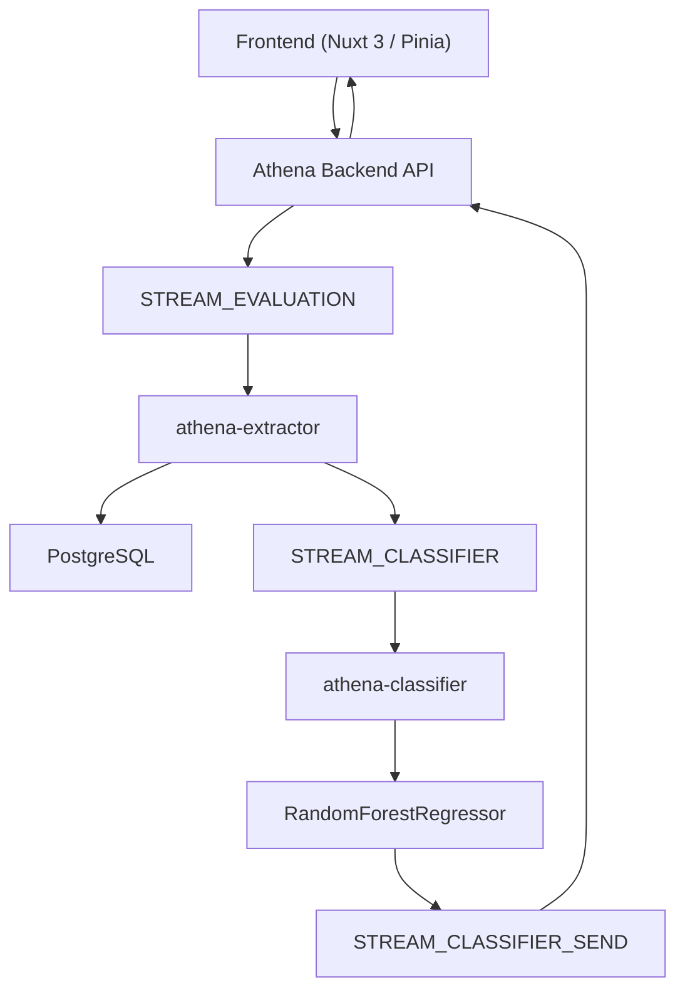

# ATHENA - Microservicio de Extracción Semántica y Flujo de Evaluación

[Índice de documentación](../../../../index.md)

---

# 1. Propósito

El microservicio de extracción semántica (`athena-extractor`) transforma las respuestas de los aspirantes en evidencia estructurada compatible con el modelo clasificador vocacional de ATHENA.

La información procesada incluye:

- Valoraciones de objetivos vocacionales.
- Selección de criterios RISEC.
- Respuestas abiertas asociadas a objetivos.
- Respuestas abiertas asociadas a dimensiones RISEC.

## Responsabilidades del Servicio

- ✅ Analizar respuestas abiertas.
- ✅ Generar coincidencias semánticas.
- ✅ Calcular afinidades (`porc_objetivo`, `porc_coincidencia`).
- ✅ Calcular evidencias (`repeticiones`).
- ✅ Persistir resultados intermedios.
- ✅ Construir y publicar eventos para clasificación.
- ✅ Integrarse con JEV para la extracción semántica.

## Prohibiciones

- ❌ No recomienda carreras.
- ❌ No genera rankings vocacionales.
- ❌ No ejecuta Random Forest.
- ❌ No realiza inferencias predictivas.
- ❌ No expone directamente JEV al frontend.

---

# 2. Arquitectura General del Sistema



## Principio Arquitectónico

El frontend nunca interactúa directamente con JEV.

Toda comunicación ocurre a través de:

```text
Frontend
    ↓
Backend
    ↓
Redis
    ↓
Extractor
    ↓
Clasificador
```

JEV permanece encapsulado dentro de `athena-extractor`.

---

# 3. Flujo Funcional del Cuestionario

## Paso 1: Datos Personales y Selección de Área

Ruta:

```text
/datos-personales
```

El usuario proporciona:

- Nombre.
- Correo.
- Avatar.
- Área seleccionada.

La API devuelve:

- Catálogo del área.
- Carreras disponibles.
- Objetivos.
- Preguntas RISEC.
- Opciones configuradas.

---

## Paso 2: Objetivos Vocacionales

Ruta:

```text
/objetivos
```

Para cada carrera:

- El usuario asigna una valoración de 1 a 5.
- El usuario redacta una justificación opcional.

Ejemplo:

```text
Valoración: 5

Me interesa la robótica y la automatización industrial.
```

---

## Paso 3: Exploración de Habilidades RISEC

Ruta:

```text
/riasec
```

El usuario responde las dimensiones:

- Realista (1)
- Investigador (2)
- Social (4)
- Emprendedor (5)
- Convencional (6)

Para cada dimensión:

- Selecciona criterios.
- Redacta una respuesta abierta.

Ejemplo:

```text
✓ Reparar dispositivos electrónicos

✓ Diagnosticar fallas

Respuesta:

Me gusta desarmar equipos y encontrar el origen de los problemas.
```

Las selecciones y la respuesta abierta forman parte de la extracción semántica.

---

# 4. Contratos de Integración

## Evento de Evaluación

```json
{
  "user_uuid": "USER-1234-ABCD",
  "area_id": 1,
  "objective_answers": [
    {
      "career_id": 101,
      "rating": 5,
      "answer": "Me apasiona la automatización industrial y la robótica."
    }
  ],
  "risec_answers": [
    {
      "riasec_id": 1,
      "selected_criteria_ids": [11, 12],
      "answer": "Me gusta reparar dispositivos y trabajar con herramientas."
    },
    {
      "riasec_id": 2,
      "selected_criteria_ids": [21],
      "answer": "Disfruto crear modelos matemáticos."
    },
    {
      "riasec_id": 4,
      "selected_criteria_ids": [],
      "answer": "Me gusta coordinar talleres."
    },
    {
      "riasec_id": 5,
      "selected_criteria_ids": [],
      "answer": "Me interesa dirigir proyectos."
    },
    {
      "riasec_id": 6,
      "selected_criteria_ids": [],
      "answer": "Prefiero tareas estructuradas."
    }
  ]
}
```

---

## Respuesta Inicial

```json
{
  "status": "accepted",
  "evaluation_id": "9f591a84-a72e-4dd8-b3e2-cb7e4ed6f5d"
}
```

La extracción y clasificación continúan de forma desacoplada utilizando Redis Streams.

---

# 5. Módulos Internos

## 5.1 Objective Extractor

### Objetivo

Determinar afinidad entre:

```text
Objetivo institucional
+
Valoración del usuario
+
Justificación textual
```

### Consulta de información

```sql
SELECT
    carrera_id,
    objetivo,
    pregunta_objetivo
FROM carreras
WHERE carrera_id = :career_id;
```

### Entradas

```json
{
  "career_id": 101,
  "rating": 5,
  "answer": "Me apasiona la robótica y la automatización industrial."
}
```

### Salida

```json
{
  "career_id": 101,
  "porc_objetivo": 0.91,
  "evidence": [
    "robótica",
    "automatización industrial"
  ]
}
```

### Persistencia

```sql
puntaje_objetivo
(
    usuario_id,
    carrera_id,
    porc_objetivo
)
```

---

## 5.2 RISEC Extractor

### Objetivo

Determinar afinidades hacia criterios RISEC utilizando:

1. Selecciones realizadas por el usuario.
2. Evidencias encontradas en texto libre.

### Consulta de criterios

```sql
SELECT
    criterio_id,
    desc_criterio
FROM criterios
WHERE area_id = :area_id
AND riasec_id = :riasec_id
AND type_id = 1;
```

### Resultado esperado

```json
{
  "matches": [
    {
      "criterio_id": 11,
      "porc_coincidencia": 0.95,
      "repeticiones": 3
    }
  ]
}
```

---

## 5.3 Construcción de Evidencias y Repeticiones

### Definición

La variable:

```text
repeticiones
```

representa la cantidad total de evidencias asociadas a un criterio.

Las evidencias pueden provenir de:

- Selecciones explícitas.
- Evidencias extraídas del texto.

### Ejemplo

Criterio:

```text
Capacitación de personal
```

Selecciones:

```text
✓ Capacitar personal

✓ Orientar personas
```

Texto:

```text
Me gusta enseñar.

También disfruto capacitar nuevos integrantes.
```

Evidencias encontradas:

```text
Selección: Capacitar personal

Selección: Orientar personas

Texto: enseñar

Texto: capacitar nuevos integrantes
```

Resultado:

```json
{
  "criterio_id": 15,
  "porc_coincidencia": 0.93,
  "repeticiones": 4
}
```

### Persistencia

```sql
usuario_criterio
(
    usuario_id,
    criterio_id,
    repeticiones,
    porc_coincidencia
)
```

---

# 6. Relación con el Clasificador

El modelo Random Forest no recibe texto libre.

Consume variables estructuradas.

## Variables de Entrada

```text
o
p

r_coinc
r_rep

i_coinc
i_rep

s_coinc
s_rep

e_coinc
e_rep

c_coinc
c_rep
```

## Origen de Variables

| Variable | Generada por |
|-----------|-----------|
| o | Objective Extractor |
| p | Criterio Principal |
| r_coinc | RISEC Extractor |
| r_rep | RISEC Extractor |
| i_coinc | RISEC Extractor |
| i_rep | RISEC Extractor |
| s_coinc | RISEC Extractor |
| s_rep | RISEC Extractor |
| e_coinc | RISEC Extractor |
| e_rep | RISEC Extractor |
| c_coinc | RISEC Extractor |
| c_rep | RISEC Extractor |

Las variables se almacenan en:

```text
puntaje_objetivo
usuario_criterio
```

y posteriormente se utilizan para generar el evento de clasificación.

---

# 7. Construcción y Publicación de ClassifierEvent

## Modelo Canónico

```python
class HabilityUser(BaseModel):
    id_hablity: int
    criteria_score: float
    quantity_repeat: int
```

```python
class ClassifierEvent(BaseModel):
    user_uuid: str
    id_area: int
    hablities_user_list: list[HabilityUser]
```

## Ejemplo

```json
{
  "user_uuid": "USER-1234-ABCD",
  "id_area": 1,
  "hablities_user_list": [
    {
      "id_hablity": 11,
      "criteria_score": 0.95,
      "quantity_repeat": 1
    },
    {
      "id_hablity": 12,
      "criteria_score": 0.88,
      "quantity_repeat": 2
    },
    {
      "id_hablity": 21,
      "criteria_score": 0.91,
      "quantity_repeat": 3
    }
  ]
}
```

---

# 8. Eventos Redis

## Recepción de Evaluaciones

```text
STREAM_EVALUATION
```

Contiene evaluaciones enviadas por usuarios.

---

## Solicitud de Clasificación

```text
STREAM_CLASSIFIER
```

Contiene eventos `ClassifierEvent`.

---

## Resultados del Clasificador

```text
STREAM_CLASSIFIER_SEND
```

Contiene resultados generados por `athena-classifier`.

---

# 9. Integración con JEV

ATHENA utiliza **JEV** como motor de extracción semántica.

JEV transforma lenguaje natural en evidencia estructurada compatible con el clasificador.

JEV no recomienda carreras ni ejecuta modelos predictivos.

Su responsabilidad es:

- Analizar lenguaje natural.
- Detectar evidencias.
- Calcular afinidades.
- Generar estructuras compatibles con ATHENA.

---

## Uso de JEV en Objective Extractor

### Contexto enviado a JEV

```json
{
  "career_id": 101,
  "objective": "Diseñar y desarrollar sistemas automatizados.",
  "question": "¿Te interesa diseñar y desarrollar sistemas automatizados?",
  "rating": 5,
  "answer": "Me apasiona la robótica y la automatización industrial."
}
```

### Responsabilidad de JEV

Determinar:

- Afinidad hacia el objetivo.
- Evidencias encontradas.
- Intensidad de coincidencia.

### Respuesta esperada

```json
{
  "career_id": 101,
  "porc_objetivo": 0.91,
  "evidence": [
    "robótica",
    "automatización industrial"
  ]
}
```

---

## Uso de JEV en RISEC Extractor

### Información enviada a JEV

El extractor construye un contexto compuesto por:

```text
Dimensión evaluada
+
Criterios del área
+
Selecciones realizadas
+
Respuesta abierta
```

### Ejemplo

```json
{
  "riasec_id": 1,
  "selected_criteria_ids": [11, 12],
  "answer": "Me gusta reparar equipos electrónicos, diagnosticar fallas y utilizar herramientas de precisión."
}
```

### Responsabilidades de JEV

Determinar:

- Coincidencias con criterios.
- Porcentaje de afinidad.
- Evidencias encontradas.
- Repeticiones detectadas.

### Respuesta esperada

```json
{
  "matches": [
    {
      "criterio_id": 11,
      "porc_coincidencia": 0.95,
      "repeticiones": 3,
      "evidence": [
        "reparar equipos",
        "diagnosticar fallas",
        "herramientas de precisión"
      ]
    }
  ]
}
```

---

## Transformación de Salida

Las respuestas producidas por JEV se convierten en registros de:

```sql
puntaje_objetivo
```

y

```sql
usuario_criterio
```

Posteriormente se construye el:

```text
ClassifierEvent
```

que será enviado al clasificador mediante:

```text
STREAM_CLASSIFIER
```

---

# 10. Flujo Completo

```text
Frontend
    │
    ▼
STREAM_EVALUATION
    │
    ▼
athena-extractor
    │
    ├──────── Objective Extractor
    │               │
    │               ▼
    │              JEV
    │               │
    │               ▼
    │       puntaje_objetivo
    │
    └──────── RISEC Extractor
                    │
                    ▼
                   JEV
                    │
                    ▼
            usuario_criterio
                    │
                    ▼
            ClassifierEvent
                    │
                    ▼
          STREAM_CLASSIFIER
                    │
                    ▼
           athena-classifier
                    │
                    ▼
         RandomForestRegressor
                    │
                    ▼
             Resultados Finales
```

## Responsabilidades Finales

### athena-extractor

Responsable de:

```text
Texto Libre
        ↓
Evidencia Estructurada
```

### athena-classifier

Responsable de:

```text
Evidencia Estructurada
        ↓
Recomendación Vocacional
```

La interpretación del lenguaje natural corresponde exclusivamente al extractor semántico. La recomendación final corresponde exclusivamente al clasificador vocacional de ATHENA.